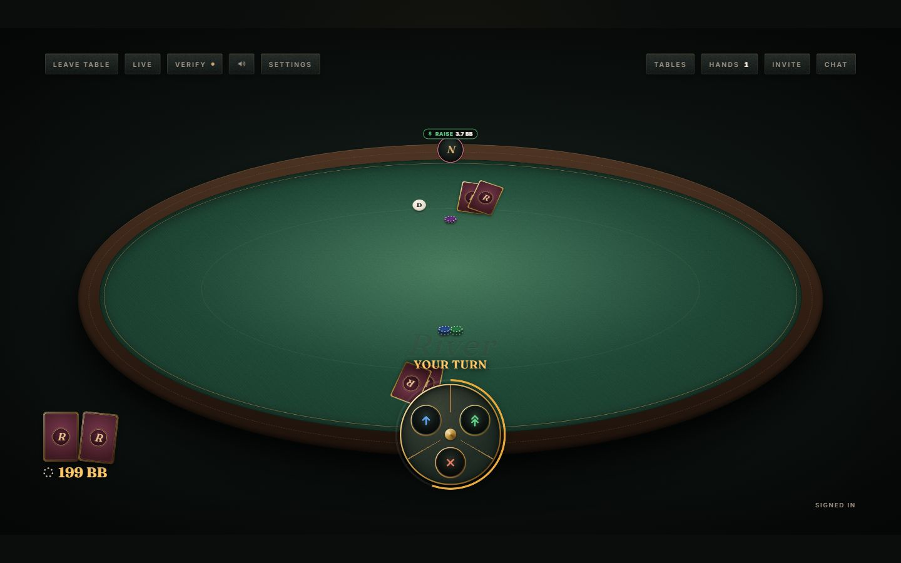
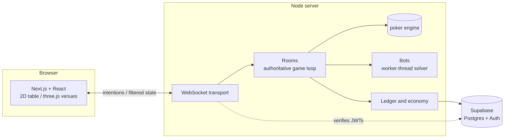

# River

Server-authoritative multiplayer Texas Hold'em for the browser.

**Live:** [playriver.uk](https://playriver.uk)



[](https://github.com/zainalibutt/River/actions/workflows/ci.yml)

## What it is

River is a poker room for friend groups: private tables behind a short link,
public tables that bots keep full, and a champion bot to challenge. It runs on
desktop and phone in a 2D layout. 3D venues and characters are built in the
same codebase and switched off in public builds until they are finished.

I designed and built River on my own, from the rules engine to the
deployment, and I run it. It has been live since September 2026. Play is with
play money only.

## Engineering highlights

- **A pure TypeScript poker engine** (`packages/engine`) shared by the server
  and the client: betting, side pots, hand evaluation, showdown order and hand
  history, with no I/O.
- **An authoritative server.** One Node process serves the Next.js app and a
  WebSocket endpoint. Clients send intentions; the server decides every
  outcome and only ever sends a player the cards they are allowed to see.
- **Verifiable dealing.** The server commits to a seed before each hand, every
  seated player contributes one, and the deck is a deterministic shuffle of
  both. After the hand anyone can recompute it. See [fairness](docs/fairness.md).
- **A chip ledger that settles every seat.** An append-only ledger in Postgres
  with idempotent references and one entry at a time per player, and
  server-side settlement for each way a seat ends. A deploy calls off any
  hand in progress and pays each player their stack and what they had bet in
  it. A crash pays back each open seat's buy-in and rebuys: the stack at that
  moment lived only in the memory the crash lost.
- **Bots that are measured, not tuned by eye.** Rule-based tiers, a CFR+ river
  solver running in a worker thread, value networks trained in PyTorch and run
  in plain TypeScript, evaluated on held-out seeds against a best-response
  opponent and an outside benchmark. See [bots](docs/bots.md). The training
  code is in [`ml/`](ml/); the trained weights and the latest bot's results
  are not published yet.
- **A scripted art pipeline.** Venues and characters are built by Blender
  Python scripts and exported to budgeted glTF assets, with the gates written as
  code. The character master scenes are kept private. See
  [art pipeline](docs/art-pipeline.md).
- **Tests at every layer**: unit tests for the engine, the server and the
  client's logic run in CI on Node 22 and 24, and Playwright tests drive the
  table interface in a real browser.

## Problems worth reading about

**Two debits at once could spend the same chips.** In an audit of the live
service I found that `apply_ledger_entry` read a balance and then inserted an
entry without locking anything. On the local database, ten debits fired
together against a bankroll with room for four, and all ten landed. The
function now locks the player's row before it reads, and
[`ledger.local.test.ts`](apps/server/src/ledger.local.test.ts) races entries
against a real Postgres to keep it that way. The same audit turned up several
more ways for chips to go missing or appear from nowhere, among them a payout
that failed every retry and still closed its seat, and a shutdown that paid out
stacks but not the chips already in the pot.

**The server could choose the deck.** When a player sent no seed, the server
filled one in after it had seen every other seed, which is enough to steer the
shuffle. Fallback seeds are now drawn and committed as the hand starts and
revealed after it. The browser verifier, which used to check only the seed
against its commitment, now reshuffles the deck and checks every card the hand
showed.

**Reloading during your own turn folded your hand.** A reload late in the turn
let the clock run out while the page came back, so the player lost the hand.
A player who drops during their turn now gets enough time to return, once per
hand, so the hold cannot be used to stall the table.

## Architecture



More detail in [architecture](docs/architecture.md).

## Start here if you are reviewing the code

| Where | What it shows |
| --- | --- |
| [`packages/engine/src/betting.ts`](packages/engine/src/betting.ts) | The betting state machine, side pots included |
| [`apps/server/src/fairness.ts`](apps/server/src/fairness.ts) | Seed commitment and the verifiable shuffle |
| [`apps/server/src/room.ts`](apps/server/src/room.ts) | The authoritative room lifecycle |
| [`apps/server/src/ledger.ts`](apps/server/src/ledger.ts) | Idempotent chip accounting and seat settlement |
| [`apps/server/src/bot-river-solver.ts`](apps/server/src/bot-river-solver.ts) | CFR+ over whole ranges on the river |
| [`apps/web/src/components/table-2d/table-2d.tsx`](apps/web/src/components/table-2d/table-2d.tsx) | The 2D table client |
| [`art/pipeline/`](art/pipeline/) | Blender-to-web venue and character builds |

## Testing

```bash
npm ci
npm run lint
npm run typecheck
npm test            # unit tests (Vitest)
npm run test:ui     # interface tests (Playwright), against a running app
```

CI runs on every pull request and every push to `main`: lint, typecheck and the unit suite on
Node 22 and 24, the database tests against a local Postgres, a secret scan, and
a browser test that plays a hand on a production build and checks that it
verifies. `main` is protected and accepts changes only when CI passes.

## Running locally

River needs Node 22 or later, and Docker for its development database: a local
Supabase stack (Postgres, Auth and REST) that the Supabase CLI runs on this
machine, bound to the loopback address.

```bash
npm ci
npm run db:start            # start the local stack; the first run pulls its images
npm run db:reset            # wipe it and start afresh with every migration
npm run db:migrate          # apply new migrations, keeping its data
npm run dev                 # server and app on http://localhost:3000, on the local stack
```

`npm run dev` and `npm run test:ui` read the local stack's URL and keys from the
CLI each time they start, so no key is written to a file. A development server
refuses a hosted Supabase project unless `RIVER_DEV_REMOTE_DATABASE=1` says one
is meant, and the unit and interface suites refuse to run against any database
that is not on this machine: the interface suite asks the running app which one
it uses. `npm run db:stop` stops the stack and keeps its data.

The local stack's settings live in `supabase/config.toml`. They are for this
machine only and are never pushed to a hosted project.

`npm run demo` plays an interactive hand against a bot in the terminal, using only the engine and no database.

## Further reading

- [Architecture](docs/architecture.md)
- [Fairness](docs/fairness.md)
- [Bots](docs/bots.md)
- [Art pipeline](docs/art-pipeline.md)
- [Decisions](docs/decisions.md)
- [Development method](docs/development-method.md)

## AI-assisted development

I used AI coding assistants throughout River, for implementation, analysis and
tooling, the way I would use any other tool. The decisions were mine: what
River is, how it is built, how the work is split, and what ships. I treated
assistant output as a draft. Nothing landed until it passed the tests, the
benchmarks and the browser checks, and anything visual was judged by eye.
[Development method](docs/development-method.md) describes the workflow.

The public Git history begins from a sanitised baseline. River predates this
repository; internal working notes, private infrastructure details and
third-party research are deliberately not included.

## Licence and assets

No licence is granted at this time: the code and assets are published for
reading and review, and all rights are reserved. Third-party material:

- Character bodies, clothing and hair are built from MakeHuman asset packs
  released under CC0.
- Fonts (Fraunces, Inter, Barlow Condensed) are served through `next/font`
  under the SIL Open Font Licence.
- Sound effects are synthesised by River's own pipeline (`art/pipeline/audio.py`).
- The intro and menu films are rendered in Blender from River's own scenes.
- Music sources and licences are recorded in `apps/web/public/audio/manifest.json`.
