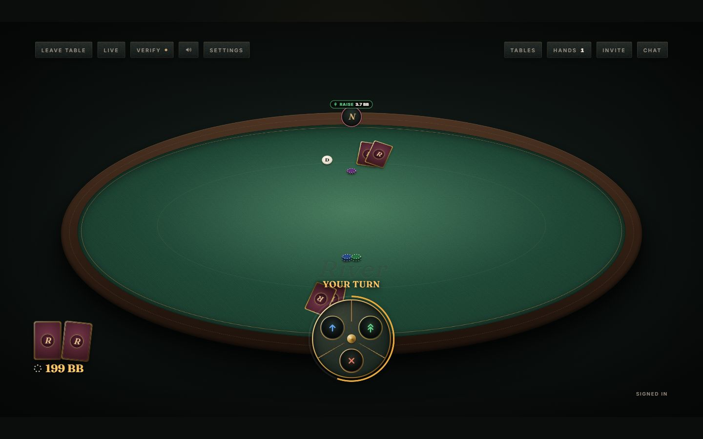
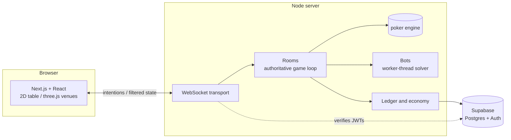

# River

Server-authoritative multiplayer Texas Hold'em for the browser.

**Live:** [playriver.uk](https://playriver.uk)



[](https://github.com/zainalibutt/River/actions/workflows/ci.yml)

## What it is

River is a poker room for friend groups: private tables behind a short link,
public tables that bots keep full, and a champion bot to challenge. It runs on
desktop and phone, in a 2D layout by default, with optional 3D venues and
characters on tables that support them.

## Engineering highlights

- **A pure TypeScript poker engine** (`packages/engine`) shared by the server
  and the client: betting, side pots, hand evaluation, showdown order and hand
  history, with no I/O.
- **An authoritative server.** One Node process serves the Next.js app and a
  WebSocket endpoint. Clients send intentions; the server decides every
  outcome and only ever sends a player the cards they are allowed to see.
- **Verifiable dealing.** The server commits to a seed before each hand, every
  seated player contributes one, and the deck is a deterministic shuffle of
  both. After the hand anyone can recompute it. See [fairness](docs/fairness.md).
- **Chips that cannot go missing.** An append-only ledger in Postgres with
  idempotent references, server-side seat settlement, and recovery that pays
  back players a crashed server left seated.
- **Bots that are measured, not tuned by eye.** Rule-based tiers, a CFR+ river
  solver running in a worker thread, value networks trained in PyTorch and run
  in plain TypeScript, evaluated on held-out seeds against a best-response
  opponent and an outside benchmark. See [bots](docs/bots.md).
- **A reproducible art pipeline.** Venues and characters are built by Blender
  Python scripts and exported to budgeted glTF assets, with the gates written as
  code. See [art pipeline](docs/art-pipeline.md).
- **Tests at every layer**: unit tests for the engine, the server and the
  client's logic run in CI on Node 22 and 24, and Playwright tests drive the
  table interface in a real browser.

## Architecture



More detail in [architecture](docs/architecture.md).

## Start here if you are reviewing the code

| Where | What it shows |
| --- | --- |
| [`packages/engine/src/betting.ts`](packages/engine/src/betting.ts) | The betting state machine, side pots included |
| [`apps/server/src/fairness.ts`](apps/server/src/fairness.ts) | Seed commitment and the verifiable shuffle |
| [`apps/server/src/room.ts`](apps/server/src/room.ts) | The authoritative room lifecycle |
| [`apps/server/src/ledger.ts`](apps/server/src/ledger.ts) | Idempotent chip accounting and seat settlement |
| [`apps/server/src/bot-river-solver.ts`](apps/server/src/bot-river-solver.ts) | CFR+ over whole ranges on the river |
| [`apps/web/src/components/table-2d/table-2d.tsx`](apps/web/src/components/table-2d/table-2d.tsx) | The 2D table client |
| [`art/pipeline/`](art/pipeline/) | Blender-to-web venue and character builds |

## Testing

```bash
npm ci
npm run lint
npm run typecheck
npm test            # unit tests (Vitest)
npm run test:ui     # interface tests (Playwright), against a running app
```

CI runs lint, typecheck and the unit suite on every push and pull request.

## Running locally

River needs Node 22 or later and a Supabase project for auth and persistence.
The Supabase CLI can run one locally in Docker.

```bash
npm ci
npx supabase start          # local Postgres, Auth and REST
npx supabase db reset       # applies supabase/migrations
cp .env.example .env.local  # fill in the local URL and keys printed by `supabase start`
npm run dev                 # server and app on http://localhost:3000
```

`npm run demo` plays an interactive hand against a bot in the terminal, using only the engine and no database.

## Further reading

- [Architecture](docs/architecture.md)
- [Fairness](docs/fairness.md)
- [Bots](docs/bots.md)
- [Art pipeline](docs/art-pipeline.md)
- [Decisions](docs/decisions.md)
- [Development method](docs/development-method.md)

## AI-assisted development

I used AI coding assistants extensively during River's development, for
implementation, analysis, tooling and bounded sub-tasks, choosing between them
by what each did best. I retained ownership of the product, architecture, task
decomposition, integration, review and release. Assistant output was not
treated as correct by default: changes had to pass automated tests, benchmarks,
browser checks and generated-asset gates, and anything visual was judged by eye
before it landed.
[Development method](docs/development-method.md) describes the workflow.

The public Git history begins from a sanitised baseline. River predates this
repository; internal working notes, private infrastructure details and
third-party research are deliberately not included.

## Licence and assets

No licence is granted at this time: the code and assets are published for
reading and review, and all rights are reserved. Third-party material:

- Character bodies, clothing and hair are built from MakeHuman asset packs
  released under CC0.
- Fonts (Fraunces, Inter, Barlow Condensed) are served through `next/font`
  under the SIL Open Font Licence.
- Sound effects are synthesised by River's own pipeline (`art/pipeline/audio.py`).
